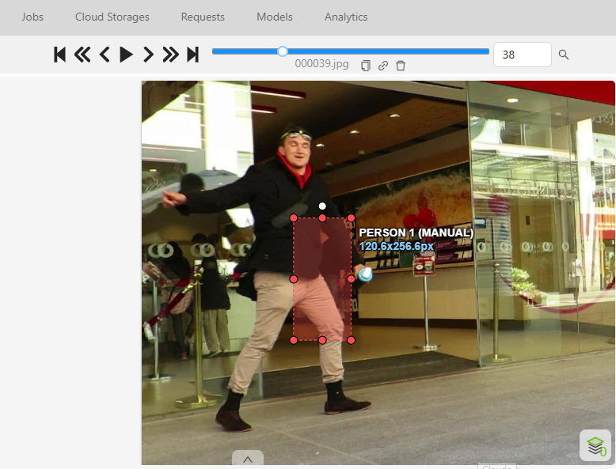
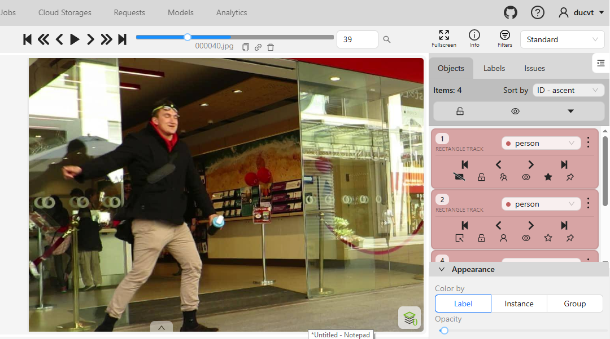
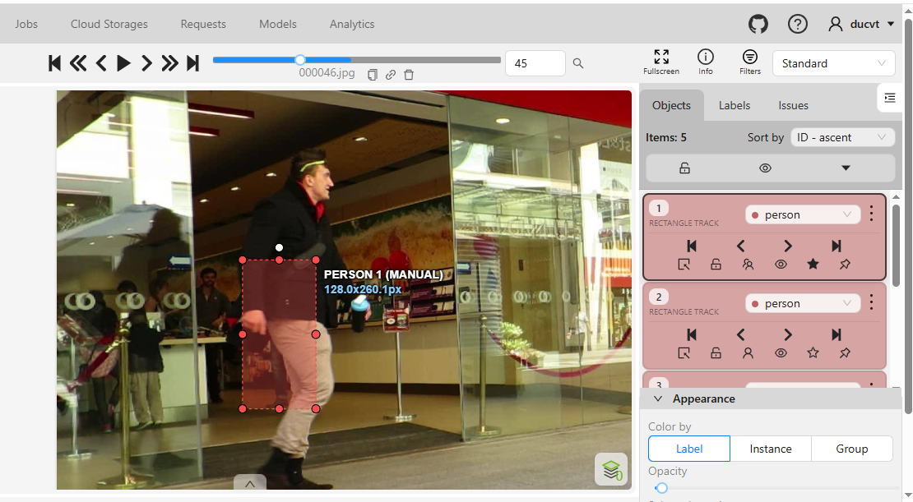

# Báo cáo cá nhân — ViThanhDuc-2A202603051

Đổi tên file theo quy tắc `MSSV_HoTen.md`. Ví dụ: `20241234_NguyenVanAn.md`.

Đoạn video: MOT17-09, 150 frame (frame 1–150), nguồn MOTChallenge, giấy phép CC BY-NC-SA 3.0.

## 0. Thông tin học viên

- Họ tên: Vi Thanh Đức
- MSSV: 2A202603051
- Mã đề (A/B/C): B
- Email: 26ai.ducvt2@vinuni.edu.vn
- Link repository: https://github.com/viduc2811/K5-L2-Day05-ViThanhDuc-2A202603051-MOTTracking
- Giờ bắt đầu: 16:25 ngày 13/11/2026
- Giờ kết thúc: 19:04 ngày 13/11/2026

## 1. Xem trước đoạn video (CP0)

Ghi **trước khi vẽ**, mỗi người một dòng.

| Mã | Frame xuất hiện | Frame cuối thấy được | Rẽ / dừng / đổi tốc độ ở frame | Bị che ở frame | Ghi chú |
|---|---|---|---|---|---|
| P1 |0 |149 | đi chậm dần từ khoảng frame 55, khựng khoảng frame 94, Lại gần camera dần| Che một phần 0–38; mất hẳn 39–44; che một phần 45–54; thấy rõ từ 55 |Ban đầu ở trong cửa hàng Vodafone, nhìn qua kính nên bị che; sau đó bước ra. Người dùng cho bài xử lý che khuất |
| P2 |0 |149 |Đi thẳng, lại gần camera liên tục, nhanh dần ở cuối (frame 110–149) |Không bị che |Phụ nữ áo khoác xanh lá, đeo túi đen, vào từ mép phải khung, đi về phía trái và phía camera |
| P3 |40 |149 |Lại gần camera và sang trái liên tục; gần như đứng lại ở frame 147–148 |Che một phần 40–69; rõ từ 70 |Nam áo xanh, đội mũ trắng, xuất hiện từ mép phải khung ở frame 40. Đi gần P2 |
| P4 |0 |146 |Nhích nhẹ sang phải tới khoảng frame 30, rồi đứng yên từ frame 30 |Che một phần 105–110; mất hẳn 111–135 (25 frame); che một phần 136–148 |Bé gái áo xanh nhạt, nhỏ nhất, đứng cạnh P5. Hiện lại sau 25 frame nên giữ cùng ID |
| P5 |0 |105 |Đứng yên từ khoảng frame 30; ra khỏi khung hoặc bị che hẳn sau frame 105 |Che một phần 91–105; mất hẳn từ 106 |Phụ nữ áo xám,  đứng cạnh P4. Hai người đứng sát nhau nên dễ nhầm ID |

## 2. Keyframe và thời gian (CP1, CP4)

Số keyframe lấy từ kết quả `src/check_submission.py`.

| Mã | Số keyframe | Keyframe ở frame | Số frame có mặt | Keyframe / 100 frame | Thời gian (phút) | Chỗ khó |
|---|---|---|---|---|---|---|
| P1 |11 |0, 10, 20, 30, 45, 50, 55, 60, 65, 94, 149 |144 |7,6 | |Ban đầu ở trong cửa hàng nhìn qua kính nên bị che (frame 0–38), mất hẳn 39–44, rồi bước ra và lại gần camera; đặt keyframe dày quanh 45–65 và 94 |
| P2 |12 |0, 10, 20, 30, 50, 60, 80, 100, 120, 130, 140, 149 |150 |8,0 | |Lại gần camera liên tục nên box phải to dần đều; nhanh dần ở cuối (110–149) |
| P3 |15 |40, 60, 70, 80, 89, 97, 103, 112, 123, 125, 130, 140, 141, 144, 147 |110 |13,6 | |Vào từ mép phải ở frame 40, bị che 40–69, lại gần camera nhanh nên box đổi kích thước mạnh; keyframe dày ở 123–147 |
| P4 |8 |0, 10, 20, 30, 105, 136, 137, 140 |124|6,5 | |Nhỏ nhất (box cao 129 px), đứng yên từ frame 30; mất hẳn 111–135, hiện lại ở 136; đứng sát P5 nên dễ nhầm ID |
| P5 |6 |2, 10, 20, 30, 50, 91 | 104 |5,8 | |Đứng yên từ khoảng frame 30; bị che một phần từ 91, track kết thúc sau frame 105; đứng sát P4 |
| **Tổng** |52 | |632 |8,2 | | |

Keyframe / 100 frame của cả bài = tổng keyframe ÷ tổng số frame có mặt × 100 = 52 : 632 × 100 = 8,2

Bạn đặt keyframe nhiều nhất ở người nào? Vì sao (người đó rẽ, dừng, lại gần camera hay bị che)?

 Em đặt nhiều nhất ở P3 (15 keyframe, 13,6 keyframe / 100 frame). P3 đi vào từ mép phải khung ở frame 40, bị che một phần tới frame 69, rồi tiến lại gần camera nhanh nên kích thước box thay đổi mạnh. Nội suy tuyến tính chỉ đúng khi tốc độ đổi kích thước không đổi, nên em phải thêm keyframe dày ở cuối (frame 123–147) để box không trôi khỏi người.

## 3. Đoạn bị che (CP2)

Người bị che: `P1`

| Mốc | Frame |
|---|---:|
| Bắt đầu bị che một phần (bật `occluded`) |0 |
| Mất hẳn (bật `outside`) |39 |
| Hiện lại (tắt `outside`) |45 |
| Thấy rõ trở lại (tắt `occluded`) |55 |

- Thời gian khuất hẳn: _6__ frame = _0,2__ giây.
- Quyết định: giữ cùng ID.
- Lý do (trả lời 3 câu: khuất bao lâu so với 60 frame, ngoại hình có khớp, chỗ hiện lại có đúng hướng và tốc độ):
  Khuất hẳn chỉ 6 frame, thấp hơn so với ngưỡng 60 frame (2 giây) của lớp.
  Ngoại hình khớp: Áo đen, đeo kính, đi giày nâu, mặc quần bò không thay đổi gì về ngoại hình so với ban đầu.
  Chỗ hiện lại đúng hướng và tốc độ cũ: ở frame 38 tâm chân box ở x = 379, đến frame 45 ở x = 388. Box dịch sang phải khoảng 1,3 px/frame, đều như trước khi khuất, và chân vẫn ở y = 706. Kích thước box cũng liền mạch.


Ảnh chụp màn hình:





## 4. Tự review ID (CP3)

Lượt 1 theo người (đi ngược từ frame 149 về 0 trên CVAT), lượt 2 theo cảnh (nhảy 10 frame). Ít nhất 3 dòng; không có lỗi thì ghi một dòng "đã kiểm hai lượt, không lỗi".

Loại lỗi dùng đúng một trong 7 mã: `id_switch`, `fragmentation`, `lost`, `merge`, `false_track`, `drift`, `flag`.

| Frame | Mã người | Loại lỗi | Mô tả một câu | Phát hiện ở lượt | Đã sửa? |
|---:|---|---|---|---|---|
|121–129 |P3 |`drift` |Khi đi cạnh P2, box P3 lệch về phía phải so với người thật giữa keyframe 125 và 130 |2 | Có, chỉnh keyframe ở frame 130 (và 125)|
|106–149 |P5 |`lost` (đã kiểm) | Nghi box kết thúc sớm; xem lại thì P5 bị P2 và P3 đi ngang che hẳn nên bật `outside` là đúng|1 |Không cần sửa |
|2–105 |P4, P5 | `merge` (đã kiểm)| Hai người đứng sát nhau, chồng box tối đa IoU 0,18 nên không bị gộp|1 |Không cần sửa |

Tổng hợp số lỗi theo loại:

| `id_switch` | `fragmentation` | `lost` | `merge` | `false_track` | `drift` | `flag` |
|---:|---:|---:|---:|---:|---:|---:|
|0 |0 |0 |0 |0 | 1|0 |

Lỗi nào chỉ lượt 2 (theo cảnh) mới thấy, lượt 1 (theo người) không thấy? Vì sao?

Lỗi `drift` của P3 ở frame 121–129 chỉ lượt 2 mới thấy. Ở lượt 1, em chỉ nhìn một mình P3 nên không để ý box lệch về phía P2; ở lượt 2, nhìn cả cảnh thấy box P3 nằm sát và lệch khỏi người khi P2 đi cạnh.

## 5. File xuất và kết quả tự kiểm (CP4)

| Kiểm tra | Kết quả |
|---|---|
| Tên file MOT 1.1 |`ViThanhDuc_mot.zip` |
| Tên file CVAT for video 1.1 |`ViThanhDuc_cvat_video.zip` |
| Số track ID khác nhau trong `gt/gt.txt` (phải là 5) | 5 |
| Frame `outside` không có dòng trong `gt.txt` (đúng / sai) |Đúng |
| Job đã completed trên CVAT máy cá nhân |Đã completed |

Dán phần tóm tắt in ra từ `src/check_submission.py`:

```
=== File MOT 1.1: ViThanhDuc_mot.zip ===
  Số track ID: 5   |   Tổng số box: 632
  [OK]        Đúng 5 track ID.

  Track | Frame có mặt | Số frame | Đoạn vắng (outside)
      1 |   0–149      |      144 | 39–44
      2 |   0–149      |      150 | -
      3 |   0–148      |      124 | 111–135
      4 |   2–105      |      104 | -
      5 |  40–149      |      110 | -


=== File CVAT for video 1.1: ViThanhDuc_cvat_video.zip ===

  Track | Nhãn   | Frame thấy | Keyframe | KF/100 frame | Frame occluded | Lần bật outside
      0 | person |        144 |       11 |          7.6 |             49 |               1
              Track 0: keyframe ở frame [0, 10, 20, 30, 45, 50, 55, 60, 65, 94, 149]
      1 | person |        150 |       12 |          8.0 |              0 |               0
              Track 1: keyframe ở frame [0, 10, 20, 30, 50, 60, 80, 100, 120, 130, 140, 149]
      2 | person |        110 |       15 |         13.6 |             30 |               0
              Track 2: keyframe ở frame [40, 60, 70, 80, 89, 97, 103, 112, 123, 125, 130, 140, 141, 144, 147]
      3 | person |        124 |        8 |          6.5 |             19 |               2
              Track 3: keyframe ở frame [0, 10, 20, 30, 105, 136, 137, 140]
      4 | person |        104 |        6 |          5.8 |             15 |               1
              Track 4: keyframe ở frame [2, 10, 20, 30, 50, 91]

  Tổng: 52 keyframe / 632 frame có mặt = 8.2 keyframe / 100 frame
  [OK]        Đọc được 5 track từ annotations.xml.

=== Tóm tắt ===
  Lỗi: 0   |   Cảnh báo: 0
  Đạt. Dán phần tóm tắt này vào báo cáo mục 5.
...
```

## 6. Ba câu kết

1. Nếu được gán lại, bạn sẽ đặt keyframe khác ở đâu? Vì sao?

   Đặt thêm keyframe cho P5 ở khoảng frame 60–90 vì P5 chỉ có 6 keyframe (5,8 keyframe / 100 frame) và đoạn giữa keyframe 50 và 91 dài 41 frame mà không có điểm kiểm; nếu người đứng lún nhẹ hoặc box trôi thì khó nhận ra.

2. Có chỗ nào bạn không chắc "cùng ID hay ID mới"? Bạn đã quyết định và ghi chú thế nào?

   P4 (bé gái) mất 25 frame khi P2 đi ngang qua; vẫn giữ cùng ID vì 25 frame ít hơn ngưỡng 60 frame, bé vẫn đứng yên đúng chỗ cũ trước và sau khi P2 đi qua.

3. Một lỗi ID trong job của bạn (nếu không còn sót, chọn lỗi đã sửa) có thể làm xe tự lái dự đoán sai chuyển động của người đó như thế nào? Lỗi đó ảnh hưởng MOTA hay IDF1 nhiều hơn?

   `id_switch` giữa P4 và P5, hai người đứng sát nhau. Nếu ID của bé gái nhảy sang người lớn bên cạnh, hệ thống sẽ tính ra vận tốc nhảy vọt từ nhãn và dự đoán sai quỹ đạo của một trẻ em. 
   Lỗi này ảnh hưởng IDF1 nhiều hơn MOTA: MOTA tính một lần đổi ID chỉ là một lỗi trong tổng số box, còn IDF1 ghép cả track với cả track nên một người mang hai ID chỉ được tính đúng một phần.

## Bonus (nếu làm)

### B1 — Hai người đi sát

...

### B2 — So cách đặt keyframe

| Cách đặt | Số keyframe | Frame trôi nhất | Ghi chú |
|---|---:|---:|---|
| Đều mỗi 30 frame | | | |
| Theo chỗ đổi hướng | | | |

...

### B3 — So với tracker có sẵn

| Frame | Mã người | Tracker làm gì | Nhãn của bạn | Giải thích (đoán rồi sửa / ghép IoU / box score thấp / ngoại hình) |
|---:|---|---|---|---|
| | | | | |
| | | | | |

## 7. Tài liệu tham khảo và công cụ AI đã dùng

Tài liệu: README, RULES, GUIDELINE, CHECKPOINTS,...của bài lab day05
Công cụ AI đã dùng: Claude, dùng để:
 Giải thích lỗi môi trường khi chạy `src/setup_local_lab.py` (thiếu thư viện `fsspec`, `aiohttp`)
 Giải thích khái niệm (fsspec, keyframe, `outside` / `occluded`, MOTA / IDF1)